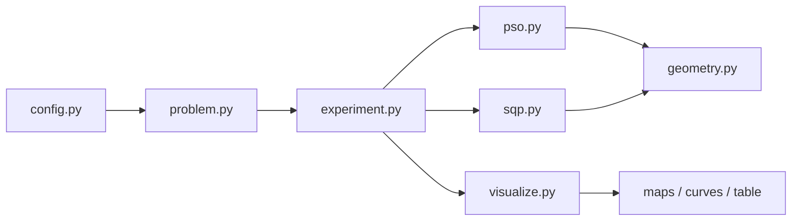

# Implementation Plan — Area Coverage Maximization under Network Connectivity in WSNs

## Confirmed Decisions
- Region M is **rectangular only**. The irregular-region extension is **out of scope**.
- SQP uses **finite-difference gradients** to start (analytic gradients only if finite differences prove too slow).
- Stack: **NumPy + SciPy + Matplotlib**. PSO is **hand-written** (do NOT use pyswarms).
- Use **fixed random seeds** for reproducibility. Use **pytest** as the test runner.

## Problem Statement
Place N sensors at continuous 2D positions in a region M to maximize the fraction of sampled
points P covered by at least one sensor (sensing radius `rs`), subject to (1) every sensor
staying inside M, and (2) the communication graph (edges where pairwise distance ≤ `rc`,
including a fixed base station) being connected. Solve with two optimization methods —
Particle Swarm Optimization (PSO) and Sequential Quadratic Programming (SQP) — and compare
solution quality and algorithm performance.

## Requirements
- Implement both PSO and SQP and produce a full comparison: coverage ratio, constraint
  satisfaction, computational time, convergence behavior, sensitivity to initial conditions.
- PSO handles connectivity via penalty/repair of disconnected layouts; SQP uses differentiable
  smooth approximations of both coverage and connectivity, with a sharpening (continuation)
  schedule.
- Deliverable is reproducible Python scripts/modules that generate coverage maps, convergence
  curves, and a comparison table, runnable from the command line.
- Stack: NumPy + SciPy + Matplotlib; PSO hand-written (no pyswarms). Fixed seeds for
  reproducibility.

## Background / Research Findings
- **Coverage objective** `C(S) = (1/|P|) · Σ_p max_i f(s_i, p)` is a sum of step functions —
  non-differentiable and flat almost everywhere, so gradient methods see no signal. Standard
  fix: replace the hard indicator `f(s,p)=1[d ≤ rs]` with a sigmoid `σ(β·(rs − d(s,p)))`, and
  the per-point max-over-sensors with a smooth aggregator (soft-OR, e.g. `1 − Π_i(1 − σ_i)`).
  The sharpness `β` is increased across a continuation schedule so the smooth objective
  converges toward the true Boolean coverage (homotopy / graduated optimization).
- **Connectivity** is a discrete graph property. The smooth surrogate is algebraic
  connectivity: build a weighted Laplacian `L` with smooth edge weights
  `w_ij = σ(β·(rc − d_ij))`, and use the second-smallest eigenvalue λ₂ (Fiedler value).
  λ₂ > 0 ⟺ the weighted graph is connected, so the SQP constraint becomes `λ₂(S) ≥ ε`. For
  true feasibility checks (PSO and final validation) use an unweighted BFS/DFS over
  `scipy.sparse.csgraph`.
- **SQP in SciPy**: `scipy.optimize.minimize(method='SLSQP')` accepts bound constraints (region
  box) and nonlinear inequality constraints (λ₂ ≥ ε). Minimize `−(smooth coverage)`. Gradients
  via finite differences to start.
- **PSO constraint handling**: penalty approach adds `−γ · (disconnection measure)` to fitness;
  repair approach nudges disconnected sensors toward the nearest connected node until the graph
  reconnects. Implement penalty first, add repair as a variant.
- **Problem characteristics for the writeup**: objective is highly multimodal (symmetric
  permutations, many local coverage optima); feasible region (connected layouts) is non-convex
  and can be disconnected. Expectation: SQP converges to local optima sensitive to start; PSO
  explores more broadly. This contrast is the central finding.

## Proposed Architecture
- `problem.py` — Problem definition: rectangular region M, sampled points P, params
  (N, rs, rc, base station).
- `geometry.py` — Vectorized distances, hard coverage ratio, soft coverage, BFS connectivity,
  Fiedler λ₂.
- `pso.py` — Hand-written PSO with penalty + repair constraint handling, convergence logging.
- `sqp.py` — SLSQP wrapper with smooth coverage objective, λ₂ constraint, continuation schedule.
- `experiment.py` — Multi-start runner, seeding, metric collection, sensitivity sweeps.
- `visualize.py` — Coverage maps, convergence curves, comparison table.
- `config.py` — Central config block (params, seeds, run settings).
- `main.py` — CLI entry point.

## Task Breakdown

### Task 1: Project scaffold, config, and problem definition
Objective: Create the package structure, `config.py` (N, rs, rc, base station, region bounds,
grid resolution for P, seeds), and `problem.py` building the rectangular region M and
discretized sampled-point set P. Set up NumPy/SciPy/Matplotlib and pytest. Also create
`IMPLEMENTATION_PLAN.md` with this full plan.
- Tests: P has expected count and lies inside M; config values load.
- Demo: a script prints the problem setup (N, |P|, region size) and confirms the environment
  is wired up.

### Task 2: Vectorized geometry and the true (hard) coverage metric
Objective: In `geometry.py`, implement vectorized Euclidean distance (sensors × points), the
hard coverage indicator, and the true coverage ratio C(S) with no double counting. Keep it
fast (inner loop).
- Tests: single sensor at center covers exactly points within rs; two overlapping sensors
  don't double-count; full-grid layout approaches 1.0.
- Demo: compute/print coverage ratio for a hand-placed layout and render a coverage map
  (covered/uncovered points, sensing circles).

### Task 3: Connectivity — true graph check and smooth Fiedler surrogate
Objective: Add the communication graph (edges where distance ≤ rc, including base station), a
BFS/DFS check over scipy.sparse.csgraph, and smooth λ₂ from a sigmoid-weighted Laplacian.
- Tests: connected layout returns connected=True and λ₂>0; isolated sensor returns
  connected=False and λ₂≈0; λ₂ increases as nodes move closer.
- Demo: for a connected and a disconnected layout, print status and λ₂ and draw comm edges on
  the coverage map.

### Task 4: Hand-written PSO with penalty-based constraint handling
Objective: Implement PSO in `pso.py` (particle init within M, velocity/position updates,
personal/global bests, inertia + cognitive/social coefficients from config). Fitness =
coverage ratio − penalty for disconnection. Clamp positions to M. Log best fitness per
iteration.
- Tests: on an easy instance PSO improves coverage and returns a connected layout; penalty
  lowers fitness of disconnected candidates.
- Demo: run PSO from one seed, print final coverage/connectivity, show convergence curve and
  final coverage map.

### Task 5: PSO repair variant and constraint-handling comparison
Objective: Add a repair operator (reconnect disconnected sensors toward nearest in-range node)
selectable via config.
- Tests: repair turns a disconnected candidate connected; repaired layouts pass the true BFS
  check.
- Demo: run penalty-PSO vs repair-PSO on the same seed, print side-by-side
  coverage/connectivity.

### Task 6: Smooth coverage objective with continuation schedule
Objective: Implement the sigmoid coverage objective with soft-OR aggregation and a β-sharpening
schedule converging toward true Boolean coverage.
- Tests: as β→large, smooth coverage approaches hard coverage for fixed layouts; smooth
  objective is finite and differentiable (finite-difference gradient non-zero where hard one is
  flat).
- Demo: plot smooth vs hard coverage for a layout across increasing β.

### Task 7: SQP (SLSQP) solver with box bounds and λ₂ constraint
Objective: Implement `sqp.py` wrapping scipy.optimize.minimize(method='SLSQP'): minimize
−smooth coverage, box constraints for M, nonlinear inequality λ₂ ≥ ε, wrapped in continuation
loop (re-solve with increasing β, warm-start from previous solution, finite-difference
gradients). Log objective per outer iteration.
- Tests: on an easy instance SQP returns a connected layout with improved coverage; final
  solution passes the true BFS check.
- Demo: run SQP from one seed, print final coverage/connectivity, show convergence curve and
  final coverage map.

### Task 8: Multi-start experiment runner and metric collection
Objective: Build `experiment.py` to run both methods from several seeded random starts,
collecting coverage ratio, true constraint satisfaction, wall-clock time, and per-iteration
convergence history into a structured result set.
- Tests: one result record per (method, seed); metrics populated; connectivity validated with
  true check, not surrogate.
- Demo: run the full multi-start experiment on a small config and print a summary table (per
  method: best/mean/worst coverage, feasibility rate, mean time).

### Task 9: Sensitivity sweeps (initial conditions and key parameters)
Objective: Extend `experiment.py` to sweep initial conditions (many seeds) and selected
parameters (N, rs/rc ratio, PSO swarm size/coefficients), capturing variation.
- Tests: sweep produces results across the configured grid; variance across seeds captured per
  method.
- Demo: plot coverage spread across seeds for PSO vs SQP, illustrating SQP's sensitivity to
  start vs PSO's broader exploration.

### Task 10: Visualization suite and final comparison report output
Objective: Finalize `visualize.py` (coverage maps with circles/base station/comm edges,
overlaid PSO-vs-SQP convergence curves, formatted comparison table across all five metrics).
Wire everything into `main.py` as a CLI running the full pipeline end to end.
- Tests: figures generated and saved; comparison table contains all methods and metrics;
  main.py runs full pipeline without manual steps.
- Demo: run `python main.py` to produce the complete set of artifacts backing the analysis of
  local-vs-global solutions and algorithm performance.
